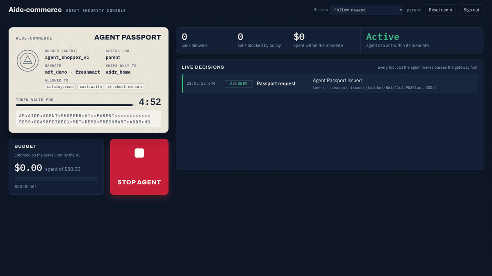
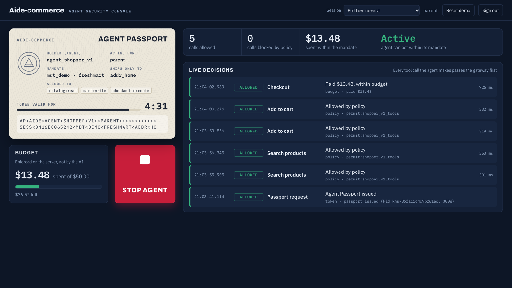
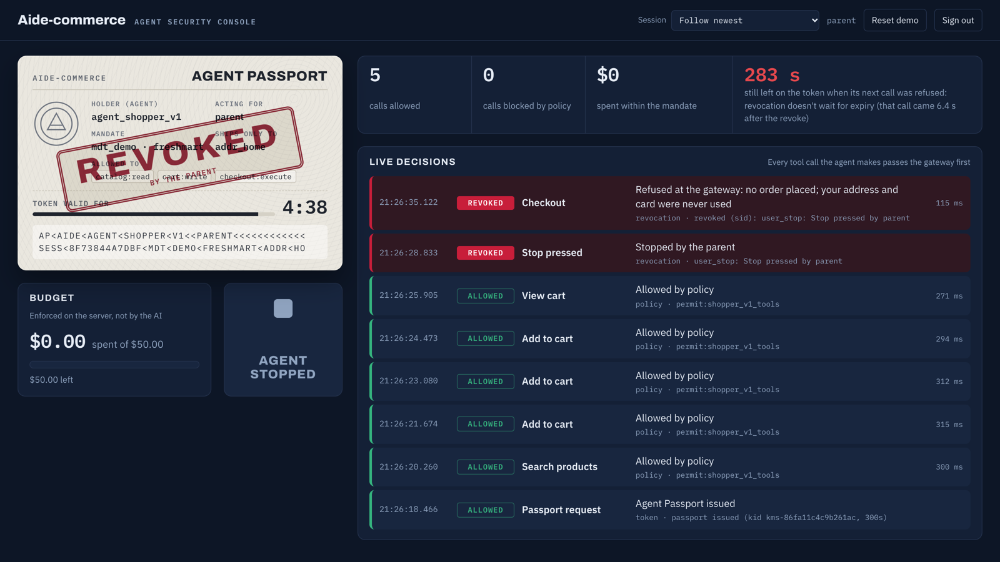
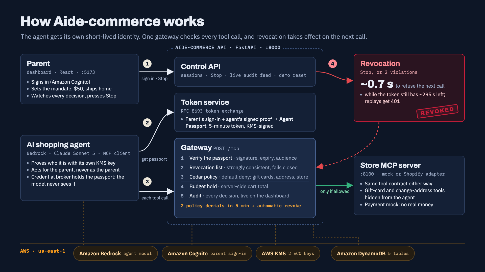

# Aide-commerce: Agentic Shopping Identity

> AWS x A10 Hack 2026, Santa Clara University · **A10 Track, Prompt 1: Agentic Identity**

AI shopping agents can now check out on their own, but today they act with the user's own login and card. Aide-commerce gives every shopping agent **its own short-lived identity**, checks **every MCP tool call** against that identity, Cedar policies and a budget, and lets a parent (or an automatic risk rule) **revoke the agent mid-task**. After a revoke, the agent's next request is refused, even though its token hasn't expired.



## The four things Prompt 1 asks for

| Requirement | How Aide-commerce does it |
|---|---|
| ✅ **Authenticate an agent** | The agent proves who it is with a single-use assertion signed by **its own KMS key**, then exchanges it with the parent's Cognito sign-in (RFC 8693) for a **5-minute Agent Passport**, KMS-signed, naming both the parent (`sub`) and the agent (`act`) |
| ✅ **Allow selected MCP tools** | The agent sees only 6 shopper tools. **Cedar** (default deny) blocks gift cards, other shipping addresses, other stores and quantities over 10. The budget is enforced on the server's own cart total |
| ✅ **Revoke access mid-task** | The parent's **Stop** button, or **automatically after 2 policy denials** (a poisoned product listing hijacks the agent) |
| ✅ **Block subsequent requests** | Every call checks a revocation list in DynamoDB (strongly consistent, no cache, fails closed): the next call is refused in **~0.7 s** while the token still has ~295 s left. Replaying a copied token gets **401**; a new passport is refused |

<p>
  
  
</p>

*Left: the real Claude agent buys within budget. Right: the parent pressed Stop, and the agent's next call was refused.*

## How it works



- **`agentpass/`**: one FastAPI app on :8000. It holds the token service, the MCP gateway (`POST /mcp`: passport → revocation list → Cedar → budget → store → audit) and the Control API used by the dashboard.
- **`agent/`**: the shopping agent: Claude Sonnet 5 on Amazon Bedrock as an MCP client, plus a credential broker that holds the passport (the model never sees tokens). It also includes a scripted driver that simulates a compromised agent.
- **`store/`**: the store MCP server on :8100. It's a mock store, or a Shopify adapter with the same tool contract, plus a payment mock (no real money).
- **`dashboard/`**: the parent's security console (React + Vite, :5173): Agent Passport, live decisions, budget, Stop button.
- **AWS:** Cognito (parent sign-in), KMS (2 ECC keys: passport signing and agent identity), DynamoDB (5 tables), Bedrock (the agent's model). Region `us-east-1`.

**Honest note on the hijack:** in our tests, real Claude Sonnet 5 recognized and refused the poisoned listing, and so did Llama 4 Scout. The hijack in the demo is therefore a simulated compromised agent (`agent shop --scenario hijacked`). The controls don't depend on the model: the gateway judges what the agent *does*.

## Run it

Needs Python 3.13 with [uv](https://docs.astral.sh/uv/) and Node 20+.

```bash
uv sync
uv run pytest                         # 42 tests, no AWS needed
(cd dashboard && npm install)
```

**Local mode** (no AWS: in-memory tables, local keys, sign in as `parent` / `parent-pass`), one terminal each:

```bash
AGENTPASS_MODE=local uv run python -m store.server --backend mock --checkout mock    # :8100
AGENTPASS_MODE=local uv run python -m agentpass                                      # :8000
cd dashboard && npm run dev                                                          # http://127.0.0.1:5173
```

Then drive the agent while watching the dashboard:

```bash
export AGENTPASS_MODE=local
uv run agent login                    # parent / parent-pass
uv run agent session start            # passport: parent + agent, 5 minutes
uv run agent shop --scenario happy    # normal purchase within budget
uv run agent session start && uv run agent shop --scenario hijacked --step-delay 1.5
                                      # poisoned listing → 2 blocked calls → auto-revoke → next call refused
uv run agent replay --expect 401      # the copied, unexpired token is useless
```

**AWS mode:** `source ~/.aws_workshop_env`, run `uv run python -m infra.setup` once (creates the DynamoDB tables, Cognito pool and KMS keys, and writes `.env`), then start the same three processes without `AGENTPASS_MODE=local`. The real model shops with `uv run agent shop "Buy notebooks and pens for school" --driver bedrock`.

**Check the whole demo** (each round resets, then tests every step above, including the Stop timing):

```bash
uv run python -m agent.demo_check --rounds 3 [--bedrock]
```

The live demo, fallbacks and morning checklist are in [`docs/demo-runbook.md`](docs/demo-runbook.md). Judge Q&A notes are in [`docs/qa-prep.md`](docs/qa-prep.md).

## Repo layout

| Folder | Contents |
|---|---|
| `agentpass/` | Token service, agent identity, MCP gateway, Cedar policies (`agentpass/policies/`), Control API, storage |
| `agent/` | Credential broker, MCP client, Bedrock shopper, scripted scenarios, `demo_check` |
| `store/` | Store MCP server, mock catalog (`seed.json`, with one poisoned listing), Shopify adapter, payment mock |
| `infra/` | `setup.py`: DynamoDB tables, Cognito user pool, KMS keys (boto3) |
| `dashboard/` | Parent's security console (React + TypeScript + Vite) |
| `tests/` | Policy, agent-identity and end-to-end tests; token-replay script |
| `docs/` | Implementation plan, scenario map, architecture, demo runbook, Q&A prep |

## Team

We are **Team Agent Zero** (logo kit in [`docs/media/logo/`](docs/media/logo/)).


| Name | GitHub | Role |
|---|---|---|
| Jack Ning | @timewalker91 | Security core: infra, token service, agent identity, gateway, Cedar policies, Control API; dashboard |
| Larry Miao | @mf523 | System architect: contracts and integration; store MCP server, Shopify adapter, shopping agent |
| Isabella Shen | @Isabellazzz | Dashboard design, demo visuals |
| Eric Wu | @edzwu9893 | Slides, business plan, Devpost, Q&A |

We used Claude Code to write much of the code. We designed the architecture and the contracts, reviewed the modules, and wrote tests for each rule. AI tools working in this repo read [`CLAUDE.md`](CLAUDE.md) and [`docs/implementation-plan.md`](docs/implementation-plan.md) first.

**Never commit AWS credentials** (`.env`, `~/.aws_workshop_env`, access keys): this repo is public.
